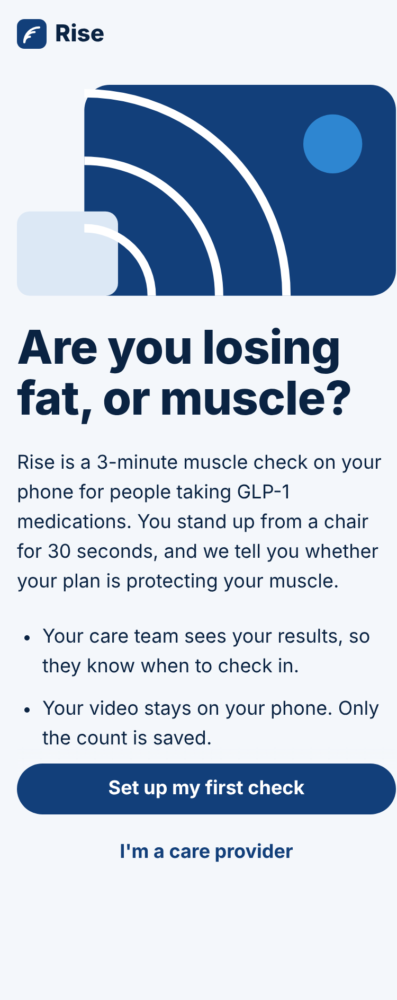
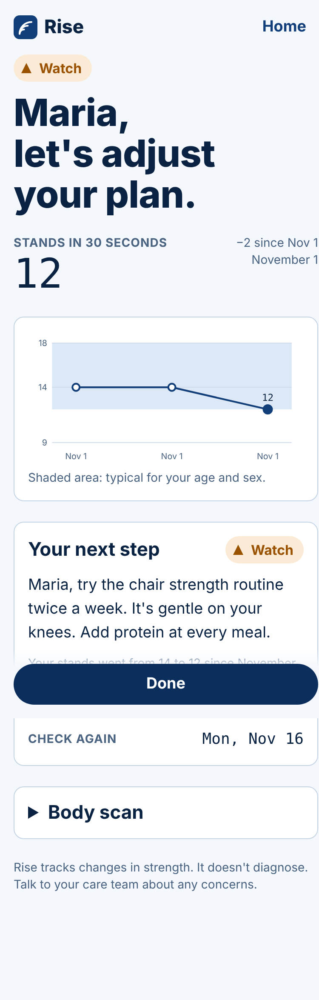
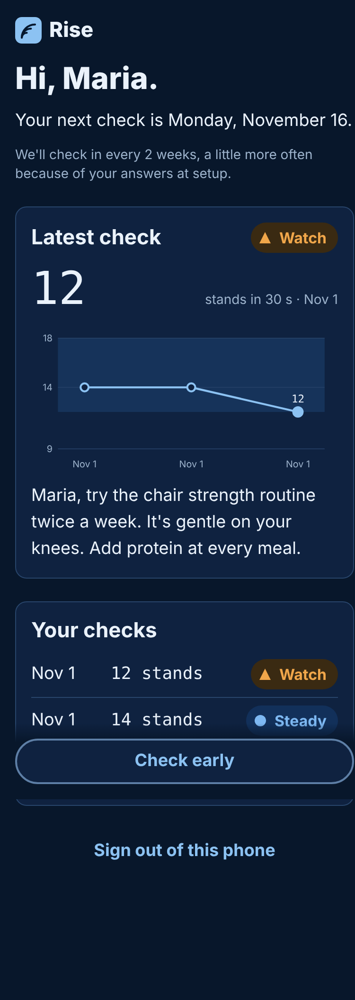
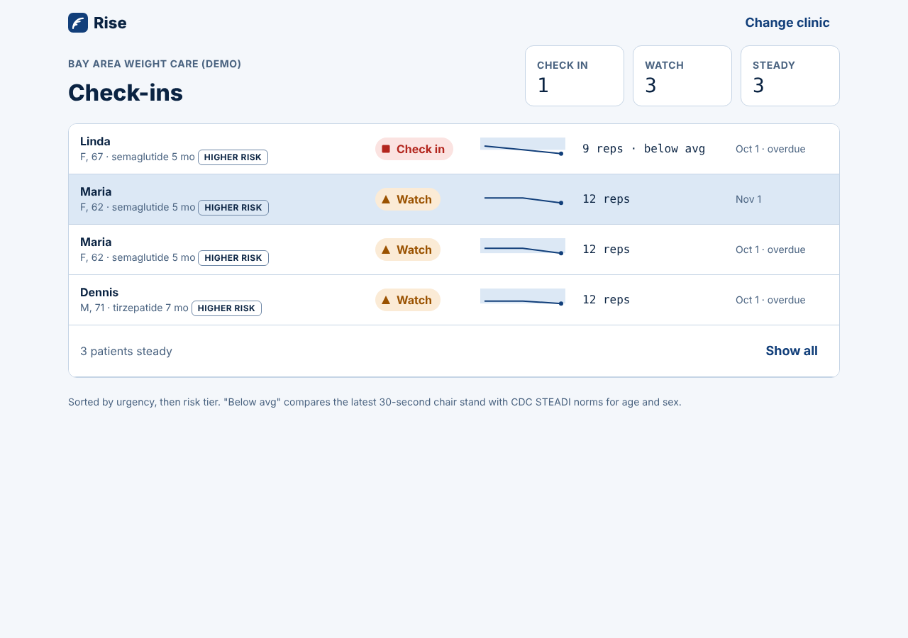

# Rise

A monthly muscle check on the phone for people taking GLP-1 medications.

Each check combines three measures of muscle health into one result for the patient and their care team:

- **Leg strength:** a 30-second sit-to-stand recorded and counted on the phone, compared with the patient's baseline and CDC STEADI norms.
- **Muscle mass:** body composition from a **Rise phone scan** (two photos), an **imported file** from a smart scale, InBody or DEXA, or typed in. Rise tracks what share of the weight lost was lean mass, compared only within the same device.
- **Grip (optional):** a home dynamometer reading, compared with EWGSOP2 cut-offs and the patient's first grip.

Rise turns these into Steady, Watch or Check in, tells the patient one thing to do next, and flags their care team when the plan isn't working. How each result is decided, with every threshold and source, is in [`docs/evaluation.md`](docs/evaluation.md).

<p>
  
  
  
</p>


## What's in the MVP

**Patient app** (installable web app, built for iPhone)
- **Risk setup:** 9 to 10 questions, one per screen (age, sex, menopause, medication, weight change, activity, falls, joint pain, personal goal, care-team code). Answers set a **Higher** or **Standard** risk tier, which sets how often the patient checks and how sensitive the flags are.
- **Readiness check:** two questions before every check (sleep, pain or illness). A rough day never flags the provider on its own.
- **Camera checks before recording:** lens smudge (image sharpness), too close, too far, side view, lighting, phone steady. One fix at a time, spoken and written. Recording starts by itself when everything passes.
- **Sit-to-stand capture:** on-device pose tracking (MediaPipe), spoken countdown, stands counted aloud, 30-second timer, hip path drawn live. Captures where the legs weren't visible most of the time are rejected with a fix.
- **Personalized result:** Steady, Watch or Check in, a verdict with the patient's name, one plain-language line per measure, trend chart, one action matched to their tier, limits and the measure that changed (for example protein first when lean share is high), their own goal, and a retest date.
- **Body composition, three ways:**
  - *Rise phone scan:* front and side photos (10-second timer, or upload). On-device pose segmentation measures neck, waist and hip; the U.S. Navy equations estimate body fat and lean mass. Photos never leave the phone.
  - *Import:* CSV or JSON exports from smart scales, InBody or DEXA services, read automatically and reviewed before saving.
  - *Type it in.*
  Entries are checked for consistency (lean mass under weight, lean plus fat adding up), and the device is saved so only like-for-like scans are compared.
- **Grip test (optional):** instructions for a home dynamometer, best of 3, in kg or lb.
- **Combined result:** one overall state from all measures, with escalation when two measures change at once or both strength tests are low.
- A manual-count fallback when the camera can't be used, marked as self-reported for providers.

**Provider dashboard**
- Check-in list sorted by urgency, then risk tier; steady patients collapse into one line.
- Patient report: "Why this result" with every reason and its reference, leg strength trend against the STEADI norm, muscle mass (weight and lean change, lean share of loss, device), grip against EWGSOP2, every check with capture confidence and readiness flags, what the patient was told and sees, risk tier and setup answers.
- Structured, record-ready export (one observation per check) as JSON.

Product rules are in [`docs/product-principles.md`](docs/product-principles.md), screens in [`docs/screens.md`](docs/screens.md) and the visual system in [`docs/design-system.md`](docs/design-system.md).

## Run it locally

Requires Node 22.5 or later.

```bash
npm run install:all
npm run dev          # API on :3001, app on http://localhost:5173
```

Open http://localhost:5173. Use care-team code **DEMO42** (a demo clinic with six example patients). The provider dashboard is at `/provider`.

**Testing the camera on an iPhone** needs an `https` link. Either deploy (below) or run `npm run dev` and expose port 5173 with a tunnel such as `cloudflared tunnel --url http://localhost:5173`, then open that link in Safari.

Production build, served by the API server:

```bash
npm run build && npm start   # http://localhost:3001
```

Optional: `npm run fetch-model --prefix web` downloads the pose model into the app so it isn't fetched from Google at runtime.

## Deploy

The repo includes a `Dockerfile` and a `render.yaml`. On [Render](https://render.com), create a new Blueprint from this repo; it builds the image and mounts a disk at `/data` for the SQLite database. Any host that runs a Docker container works the same way.

## Tests

```bash
npm test
```

- `server/test/rules.test.js`: risk tiers, STEADI norms, lean share, same-device comparison, EWGSOP2 grip and muscle cut-offs, combining measures, readiness flags and personalized copy.
- `server/test/api.test.js`: intake, checks and provider endpoints end to end.
- `web/src/lib/__tests__`: rep counting, camera checks and image sharpness, light and motion measures.

## Project layout

```
server/   Express API, SQLite (node:sqlite), rules engine, demo seed
web/      React + Vite app: patient app, camera pipeline, provider dashboard
docs/     Product principles, screens, design system, screenshots
```

## Before real patients use it

- **Sign-in.** Providers open their list with a clinic code and patients are remembered on their phone. Add real authentication and access control first.
- **Clinical review.** Risk tiers and Watch/Check-in thresholds are drafts from customer discovery. Set them with clinical advisors.
- **Validation.** Phone-video counting is labeled a pilot measure. Validate it against in-person 30-second chair stands, including older adults and people with obesity.
- **Regulatory and privacy.** Have a regulatory advisor review the flagging logic, and complete a HIPAA review before storing real health data.
- **Body scan accuracy.** Validate the Rise phone scan against DEXA in your target patients before relying on it, or license a validated scan SDK (Prism Labs and Spren both offer one) behind the same `rise-scan` step. See [`docs/legal-notes.md`](docs/legal-notes.md).
- **Grip.** A Bluetooth dynamometer would remove typing errors.
